# Support Triangle AI Agent

A workflow-based AI customer support agent built with **LangGraph, LangChain, OpenAI, and Gradio**. The agent handles different customer-support requests through structured workflows, conditional routing, tool execution, and human review when required.

---

## Overview

Customer-support requests can require different actions depending on the type of request and the information associated with it.

This project demonstrates how an AI agent can route different customer requests through appropriate workflows instead of treating every request as a simple question-and-answer interaction.

The agent currently supports:

* Order status checking
* Refund processing and eligibility validation
* Human approval for higher-value refunds
* Customer complaint escalation

The application provides a **Gradio-based customer interface**, while human approval is demonstrated separately through the support-agent terminal during testing.

### Project Flow

```text
Customer Request
       ↓
AI Support Agent
       ↓
Identify Request Type
       ↓
┌──────────────┬───────────────┬───────────────┐
│ Order Status │    Refund     │  Complaint    │
└──────┬───────┴───────┬───────┴───────┬───────┘
       ↓               ↓               ↓
Order Data       Eligibility       Escalation
Check            Check             Workflow
                       ↓
                Refund Decision
                 ┌─────┴─────┐
                 ↓           ↓
              Auto       Human Review
              Refund      Required
                 │           │
                 └─────┬─────┘
                       ↓
                Customer Response
```

---

## Problem Statement

A customer-support system may need to handle different types of requests, such as:

* "Where is my order?"
* "Can I get a refund?"
* "I want to complain about my order."

Each request can require a different workflow.

For example, a refund may require checking:

1. Whether the order was delivered
2. Whether the refund request is within the allowed time period
3. Whether the refund has already been completed
4. Whether the refund amount requires human approval

The objective of this project is to demonstrate how an AI agent can coordinate these different steps through a structured workflow.

---

## Solution

The Support Triangle AI Agent uses **LangGraph** to define and control the workflow.

The agent:

1. Receives a customer request.
2. Determines the appropriate support workflow.
3. Performs required checks using tools and CSV-based data.
4. Routes the request based on the results.
5. Automatically completes eligible actions where appropriate.
6. Requests human review when required.
7. Returns the resulting status to the customer interface.

This creates a workflow in which the AI agent handles automated support operations while certain decisions can involve a human support agent.

---

## Architecture

The agent workflow is implemented using LangGraph.

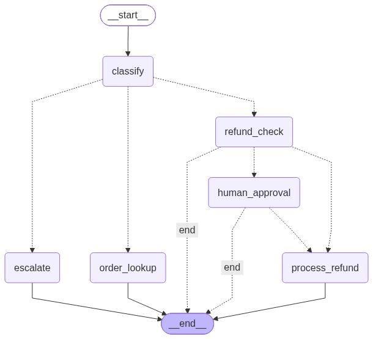

The project is organized into three main Python files:

```text
tools.py
    ↓
Business / Support Tools
    ↓
graph_flow.py
    ↓
LangGraph Workflow
    ↓
deployment.py
    ↓
Gradio Customer Interface
```

### `tools.py`

Contains the tools and supporting functions used by the agent, including:

* Order-related operations
* Refund-related operations
* Conditional checks
* Escalation handling
* CSV data loading and processing

### `graph_flow.py`

Defines the LangGraph workflow, including:

* Graph state
* Workflow nodes
* Conditional routing
* OpenAI model integration
* In-memory checkpointing

### `deployment.py`

Provides the Gradio interface used to interact with the AI support agent.

---

## Gradio Customer Interface

The customer-facing interface is implemented using **Gradio**.

The customer can enter a support request and receive the agent's response through the interface.

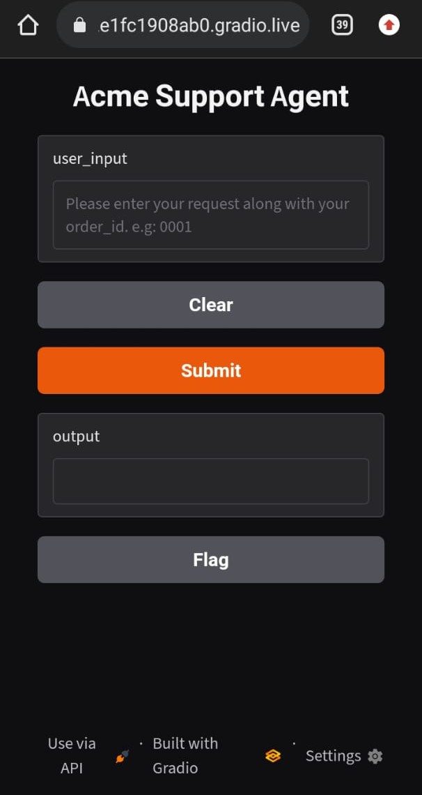

During testing, the Gradio application was launched with a shareable link and accessed through a mobile phone browser to simulate the customer perspective.

---

# Supported Scenarios

## 1. Order Status — Valid Order ID

The customer provides an order ID that exists in the order data.

The agent:

* Searches the order information.
* Retrieves the corresponding order status.
* Returns the result through the customer interface.

### Test Result

✅ Passed

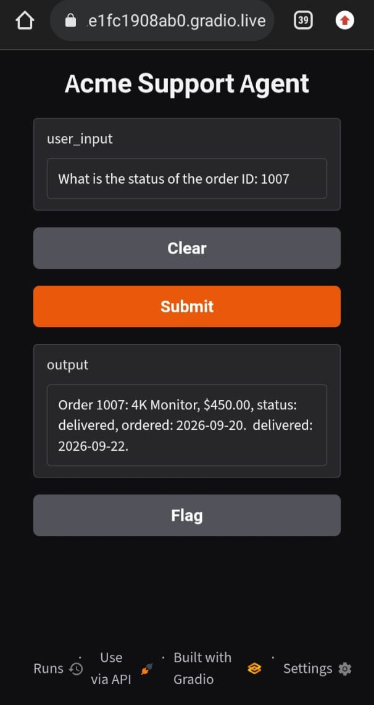

---

## 2. Order Status — Unavailable Order ID

The customer provides an order ID that does not exist in the available order data.

The agent handles the missing order instead of returning an order status that does not exist.

### Test Result

✅ Passed

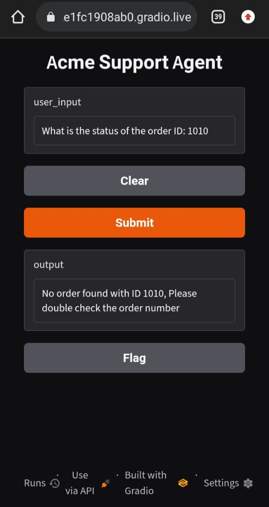

---

# 3. Refund Handling

Refund requests follow a conditional workflow.

## Step 1 — Refund Eligibility

The refund workflow first checks whether the request satisfies the defined eligibility conditions.

A refund is considered eligible when:

* The order has been delivered.
* The refund request is within the **30-day eligibility period**.

The workflow also checks whether the refund has already been completed.

## Step 2 — Refund Decision

For an eligible refund:

```text
Refund Request
      ↓
Eligibility Check
      ↓
Already Refunded?
      │
      ├── Yes → Refund Already Completed
      │
      └── No
           ↓
      Refund Amount
        ┌───┴───┐
        ↓       ↓
      ≤ $100   > $100
        ↓       ↓
     Automatic  Human Review
      Refund     Required
                   ↓
              Approve / Deny
```

### Refund Paths Tested

#### Already Refunded

If the order ID is already present in `refunds.csv`, the workflow identifies that the refund has already been completed.

### Test Result

✅ Passed

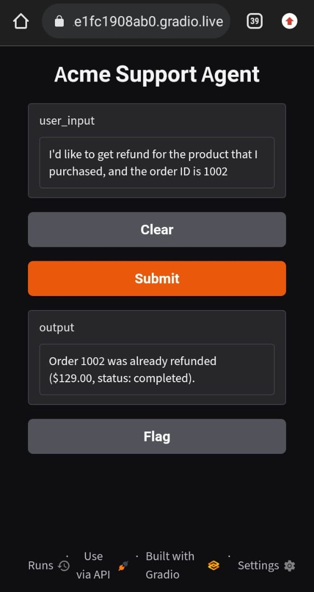

---

#### Eligible Refund — Amount ≤ $100

An eligible refund below or equal to the defined threshold can proceed through the automatic refund path.

### Test Result

✅ Passed

> The automatic refund path was tested successfully. No dedicated screenshot is included for this branch.

---

#### Eligible Refund — Amount > $100

An eligible refund above the defined threshold requires human review.

During testing, the support-agent decision was entered through the terminal.

### Human Approval Required

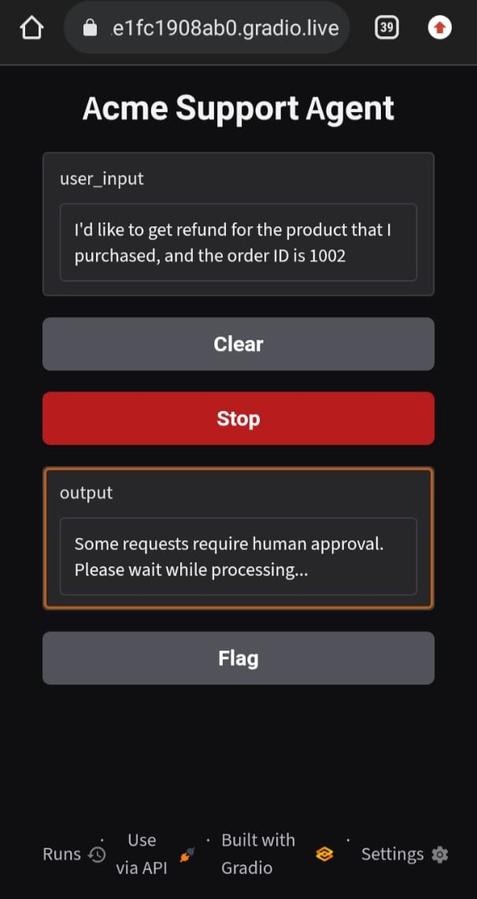

### Human Approval — Accepted

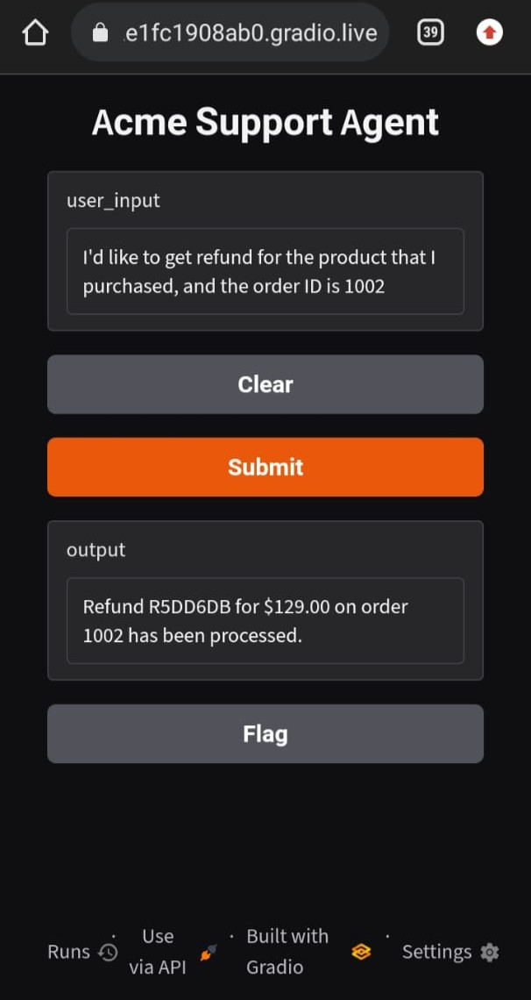

### Human Approval — Denied

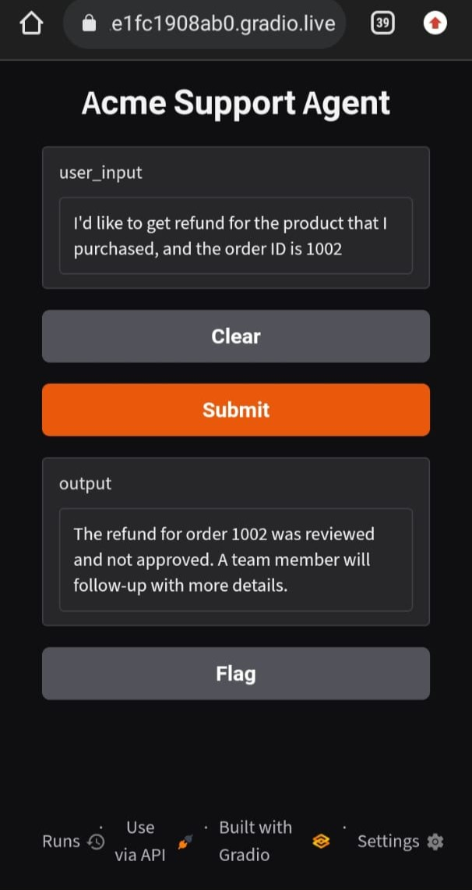

### Test Result

✅ Passed — both approval and denial paths were tested.

---

# 4. Customer Complaint — Escalation

When a customer raises a complaint requiring escalation, the agent triggers the escalation workflow and creates an escalation ticket for further support handling.

### Test Result

✅ Passed

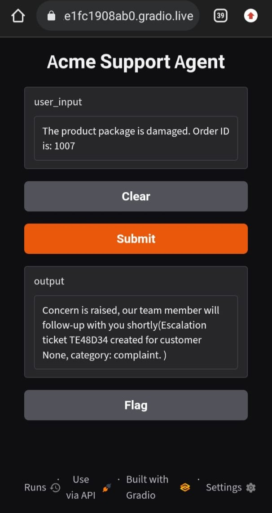

---

# Human-in-the-Loop Workflow

One of the key demonstrations in this project is the interaction between the customer-facing interface and the support-agent side.

### Customer Perspective

The customer interacts with the Gradio interface through a browser.

For testing, the Gradio application was made shareable and accessed from a mobile phone.

```text
  Customer
     ↓
Gradio Interface
     ↓
AI Support Agent
     ↓
Human Review Required
```

### Support-Agent Perspective

When human approval is required, the approval request is handled through the terminal during the prototype testing.

The support agent can enter:

```text
yes
```

to approve the request, or:

```text
no
```

to deny it.

The resulting decision is then reflected in the customer-facing interface.

```text
                 ┌───────────────┐
                 │   Customer    │
                 │    Mobile     │
                 └───────┬───────┘
                         │
                         ↓
                 AI Support Agent
                         │
                         ↓
                  Human Approval
                         │
                         ↓
                 ┌───────────────┐
                 │ Support Agent │
                 │    Terminal   │
                 └───────┬───────┘
                         │
                    Approve / Deny
                         │
                         ↓
                 Customer Interface
```

### Support-Agent Terminal — Approval Request

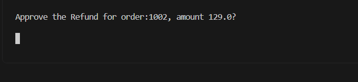

### Support-Agent Terminal — Approved

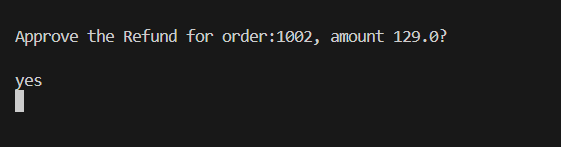

### Support-Agent Terminal — Denied

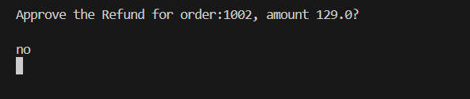

This demonstrates a basic **human-in-the-loop support workflow** where the AI handles the automated workflow while a human can make decisions for cases requiring additional review.

> **Note:** Terminal-based approval was used as the support-agent interaction mechanism during prototype testing. A production implementation could replace this with a dedicated support-agent dashboard or approval interface.

---

# Testing

The workflow was manually tested across the following scenarios:

| Workflow     | Test Case               | Result   |
| ------------ | ----------------------- | -------- |
| Order Status | Valid order ID          | ✅ Passed |
| Order Status | Unavailable order ID    | ✅ Passed |
| Refund       | Already refunded        | ✅ Passed |
| Refund       | Eligible refund ≤ $100  | ✅ Passed |
| Refund       | Eligible refund > $100  | ✅ Passed |
| Refund       | Human approval — Accept | ✅ Passed |
| Refund       | Human approval — Deny   | ✅ Passed |
| Escalation   | Customer complaint      | ✅ Passed |

### End-to-End Human Approval Test

The human-approval workflow was tested from both perspectives:

**Customer side**

* Request submitted through the Gradio interface on a mobile browser.
* Agent identified that human review was required.
* Customer interface displayed the processing state.

**Support-agent side**

* Approval request was presented through the terminal.
* Both `yes` and `no` decisions were tested.
* The resulting decision was reflected back in the customer interface.

This provided an end-to-end demonstration of the customer-facing and support-agent workflow.

---

# Technologies Used

| Technology       | Purpose                                |
| ---------------- | -------------------------------------- |
| Python           | Application development                |
| LangGraph        | Agent workflow and conditional routing |
| LangChain Core   | Tools, prompts, and core components    |
| LangChain OpenAI | OpenAI model integration               |
| OpenAI           | Language model                         |
| Pydantic         | Structured data validation             |
| Pandas           | CSV/data processing                    |
| Gradio           | Customer-facing interface              |

---

# Project Structure

```text
Support-Triangle-LangGraph-Agent/
│
├── tools.py
├── graph_flow.py
├── deployment.py
│
├── requirements.txt
├── .env.example
├── .gitignore
├── README.md
│
└── data/
    ├── customers.csv
    ├── orders.csv
    ├── refunds.csv
    ├── tickets.csv
│
└── screenshots/
    ├── LangGraph_FlowDiagram.png
    ├── Screenshot_1_UI.jpeg
    ├── Screenshot_2_Escalation.jpeg
    ├── Screenshot_3_Refund_HumanApproval_Waiting.jpeg
    ├── Screenshot_4_HumanApprovalDenied.jpeg
    ├── Screenshot_5_HumanApprovalAccepted.jpeg
    ├── Screenshot_6_DuplicateRefund.jpeg
    ├── Screenshot_7_OrderStatusInquiry.jpeg
    ├── Screenshot_8_UnavailableOrderStatus.jpeg
    ├── Screenshot_RefundBackendApproval.png
    ├── Screenshot_RefundBackendApprovalAccepted.png
    └── Screenshot_RefundBackendApprovalDenied.png
```

---

# Data Used

The project uses CSV files to simulate support-system data.

The data supports operations such as:

* Order status lookup
* Refund eligibility checks
* Refund completion checks
* Escalation

This allows the agent to demonstrate support workflows without requiring a live e-commerce backend.

> The repository should contain only sample/non-sensitive data. No customer or business-sensitive information should be committed.

---

# Installation & Setup

## 1. Clone the repository

```bash
git clone <your-github-repository-url>
cd Support-Triangle-LangGraph-Agent
```

## 2. Create or activate a Python environment

A dedicated Python environment is recommended for the project.

Use the Python version compatible with the tested project environment. For example, using Anaconda:

```bash
conda create -n support_triangle python=3.11
conda activate support_triangle
```

## 3. Install dependencies

```bash
pip install -r requirements.txt
```

---

# Environment Variables

The application requires an OpenAI API key.

Create a local `.env` file based on `.env.example`:

```text
OPENAI_API_KEY=your_openai_api_key_here
```

The repository contains `.env.example` as a template but does **not** contain the actual API credentials.

### Security

Never commit the real `.env` file or an actual API key to GitHub.

The `.gitignore` file is configured to exclude `.env`.

---

# Running the Application

After activating the project environment and configuring the API key:

```bash
python deployment.py
```

The Gradio interface will launch locally.

The application can then be accessed through the URL provided by Gradio.

---

# Limitations

This project is a **portfolio prototype designed to demonstrate an AI-agent workflow**. It is not presented as a production-ready customer-support platform.

Current limitations include:

* CSV files are used instead of a production database.
* The refund workflow is simulated rather than connected to a real payment gateway.
* Order information is based on sample data.
* Escalation is demonstrated through the implemented workflow rather than a production ticketing platform.
* Human approval is demonstrated through the development environment terminal.
* Authentication and user management are not implemented.
* Production deployment, monitoring, logging, and security hardening are outside the current scope.

---

# Future Improvements

Possible extensions for a production-oriented implementation include:

* Connect to a real order-management system through APIs.
* Integrate with a payment/refund API.
* Replace CSV files with a database.
* Connect escalation workflows to platforms such as Zendesk or another ticketing system.
* Provide a dedicated support-agent dashboard for human approval.
* Add authentication and role-based access.
* Add persistent conversation history.
* Add production logging and monitoring.
* Deploy the application to a cloud environment.
* Add automated testing for individual workflows and tools.

---

# Key Learning Outcomes

Through this project, I practiced building a workflow-based AI agent using:

* LangGraph state-based workflows
* Conditional routing
* Tool-based execution
* LangChain tools and prompts
* OpenAI model integration
* Structured data validation with Pydantic
* CSV-based data processing with Pandas
* Human-in-the-loop workflow concepts
* Gradio-based AI application interfaces
* End-to-end workflow testing

---

# Project Purpose

This project was developed as part of my practical learning journey in **AI, Generative AI, and AI Agent development**.

It demonstrates my ability to design and implement a structured AI-agent workflow for a realistic business-support use case using **LangGraph, LangChain, OpenAI, Python, and Gradio**.

The project focuses on practical implementation and workflow orchestration rather than presenting itself as a production customer-support system.
